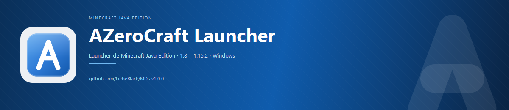

<p align="center">
  
</p>

# AZeroCraft Launcher

**Desarrollado por [Liebe Black](https://github.com/LiebeBlack)** ·
[Repositorio en GitHub](https://github.com/LiebeBlack/MD)

> [Documentación web](docs/index.html), publicable en GitHub Pages desde
> la carpeta `/docs`.

Lanzador ligero para Minecraft Java Edition, desde 1.7 hasta las versiones
actuales, incluidas las versiones con numeración de calendario 26.x. Ofrece
instalación automática, gestión de perfiles y mods, inicio de sesión opcional
con Microsoft y ajustes de rendimiento, con una interfaz de escritorio para
Windows.

## Características

- Instala las versiones disponibles en el manifiesto oficial de Mojang,
  incluidos el cliente, las bibliotecas, los archivos nativos y los recursos;
  verifica las descargas mediante SHA-1 o SHA-256 cuando se dispone de hash.
- Detecta instalaciones de Java y puede descargar Microsoft Build of OpenJDK
  cuando hace falta. La versión recomendada depende de Minecraft y de la
  compatibilidad del juego.
- Instala perfiles de OptiFine, Forge, Fabric y NeoForge. Los perfiles se
  organizan junto a las versiones de Minecraft y pueden convivir sobre una
  misma versión base.
- Incluye un gestor de mods `.jar` que muestra los metadatos disponibles,
  permite añadir o quitar mods y advierte sobre incompatibilidades detectadas.
  Si corresponde, ofrece instalar el loader necesario.
- Permite jugar con un perfil offline de nombre personalizado o vincular una
  cuenta Microsoft mediante un código de dispositivo. El inicio de sesión
  oficial es opcional y no se solicita la contraseña en el launcher.
- Ofrece controles de rendimiento para la memoria RAM, la prioridad del
  proceso, la afinidad de CPU, el recolector de basura y los argumentos JVM.
  La recomendación automática adapta la memoria y el recolector al hardware.
- Incluye temas claro y oscuro, selector de versiones con búsqueda, navegación
  por pestañas, registro de actividad y un historial local de instalaciones y
  sesiones.
- Permite conectar directamente a un servidor y ejecutar perfiles instalados
  sin conexión cuando los archivos necesarios ya están en la caché local.
- Comparte la carpeta oficial `%APPDATA%\.minecraft` con el launcher de
  Mojang. La carpeta de datos propia conserva los ajustes, la caché, Java y
  los registros del launcher; su ubicación se puede configurar mediante
  `AZEROCRAFT_DATA`.

## Requisitos

- Windows 10 u 11 para la interfaz. El núcleo contempla Linux y macOS.
- Para desarrollo: Python 3.15 con GIL y las dependencias de
  `requirements.txt`. PyQt6 no es compatible con Python free-threaded
  (`3.15t`). También se puede usar el ejecutable o el instalador publicados.

## Desarrollo y pruebas

```powershell
python -m venv .venv
.venv\Scripts\Activate.ps1
pip install -r requirements.txt
python main.py                 # o: python -m azero
python -m unittest discover -s tests -v
python tools\verify_version.py 1.12.1
```

`verify_version.py` comprueba la resolución del manifiesto, el perfil, las
bibliotecas, los archivos nativos, los recursos y la línea de comandos; además,
verifica por HTTP que respondan las direcciones de descarga. No descarga el
juego completo.

## Compilación

```powershell
.\build.ps1              # Ejecutable en dist\AZeroCraft\
.\build.ps1 -Installer   # También crea el instalador (requiere Inno Setup 6)
```

El instalador se configura para el usuario actual, sin privilegios de
administrador, y crea accesos directos en el menú Inicio y, opcionalmente, en
el escritorio. También se puede compilar directamente con Inno Setup:

```powershell
ISCC installer\setup.iss
```

## Publicación

El workflow `.github/workflows/release.yml` compila los artefactos para Windows
cuando se publica un tag que empieza por `v`:

```powershell
git tag vX.Y.Z
git push origin vX.Y.Z
```

El release incluye el instalador y un archivo ZIP con la versión portable.
También se puede ejecutar manualmente desde **Actions → Release**. Para
compilar el instalador localmente se necesita
[Inno Setup 6](https://jrsoftware.org/isinfo.php).

## Estructura del proyecto

```text
main.py                  # Punto de entrada
azero/                   # Núcleo y aplicación PyQt6
  app.py                 # Inicio de la aplicación
  paths.py               # Ubicaciones de datos y de .minecraft
  manifest.py            # Manifiestos y perfiles de versiones
  install.py             # Descarga e instalación de versiones
  libraries.py           # Bibliotecas, classpath y archivos nativos
  assets.py              # Índices y recursos del juego
  java.py                # Detección y descarga de Java
  launch.py              # Comando de inicio y ajustes del proceso
  optifine.py            # Instalación de perfiles de OptiFine
  loaders.py             # Instalación de Fabric y NeoForge
  forge.py               # Instalación de Forge
  msauth.py              # Autenticación de Microsoft
  database.py            # Historial y cuentas (SQLite)
  ui/                    # Ventana, páginas, temas y widgets
installer/setup.iss      # Instalador de Inno Setup
tools/verify_version.py  # Verificación de versiones
tests/                   # Pruebas unitarias
```

## Aviso legal

AZeroCraft Launcher es un proyecto independiente de **Liebe Black** y no está
afiliado a Mojang AB ni a Microsoft. No incluye ni redistribuye archivos del
juego; los recursos se descargan durante la ejecución desde los servidores
oficiales. Para jugar en servidores oficiales o en Realms se necesita una
cuenta válida de Minecraft. El software se ofrece «tal cual», sin garantías.
Consulta las [condiciones de uso](installer/license.txt).

## Notas

- Minecraft hasta la versión 1.12.2 usa `minecraftArguments`; desde la 1.13
  se emplea `arguments`, y las versiones 26.x también pueden declarar
  `default-user-jvm` y `versionRange`.
- El juego se inicia como un proceso independiente. Si está activada la opción
  correspondiente, el launcher puede cerrarse después del arranque.
- El modo sin conexión usa los archivos disponibles localmente; no equivale a
  iniciar sesión con una cuenta oficial ni garantiza que todas las versiones
  estén instaladas.
